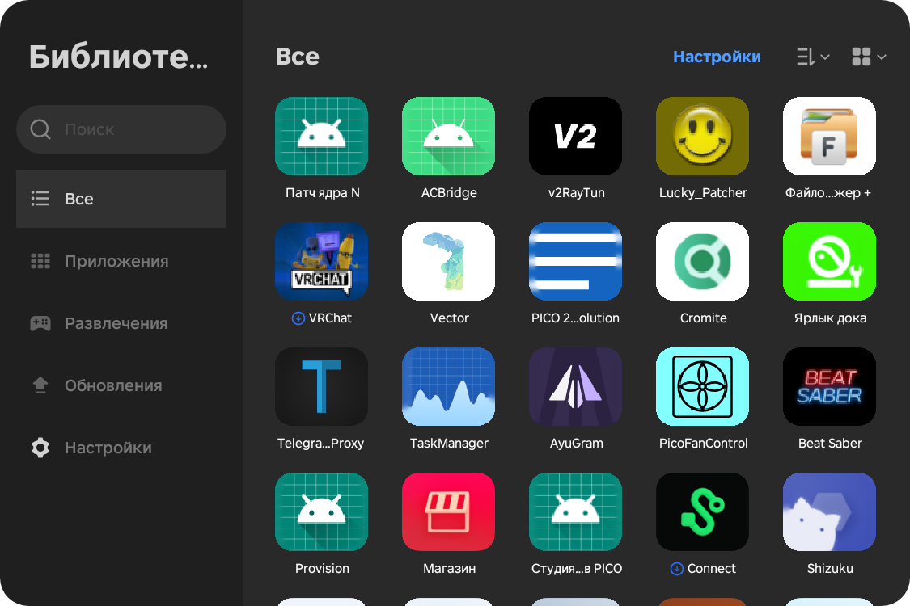
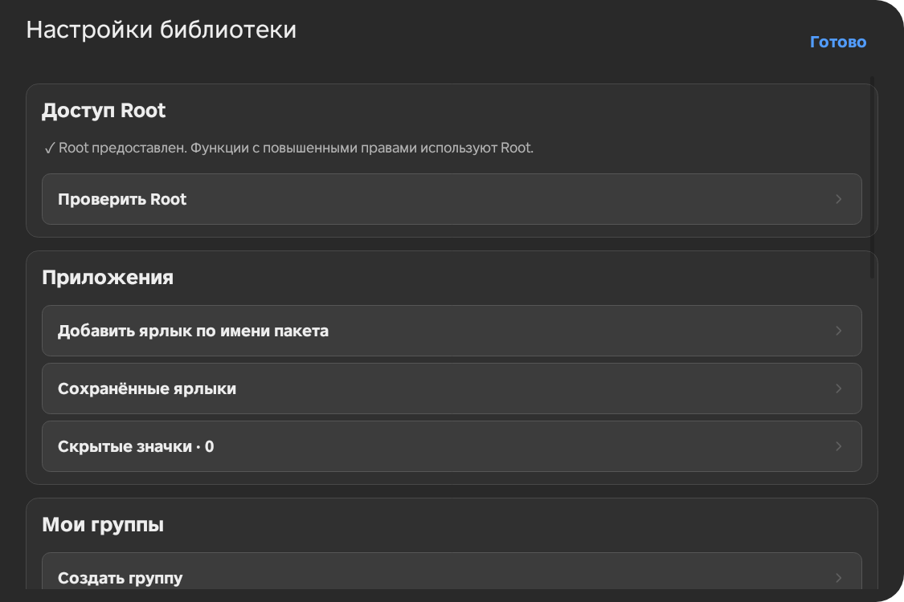

# Pico Library Plus

**Модифицированная библиотека приложений для PICO 4 с расширенными возможностями управления, группировки и персонализации.**

Pico Library Plus — модификация оригинального приложения «Библиотека» из PICO OS, сохраняющая привычный интерфейс и добавляющая функции, которых не хватает в стандартной версии.

Проект поддерживает два варианта установки: **как отдельное приложение** или **в качестве замены системной библиотеки через Magisk**.


---

## Скриншоты

| Библиотека приложений | Настройки |
|:---:|:---:|
|  |  |

*Скриншоты демонстрируют интерфейс модифицированного приложения.*

## Возможности

### Управление приложениями

- **Принудительная остановка** — возможность завершать работу установленных приложений непосредственно из библиотеки.
- **Скрытие иконок** — скрывайте ненужные приложения из пользовательского отображения без их удаления.
- **Добавление по имени пакета** — добавляйте приложения в библиотеку вручную, используя их Android Package Name (например, `com.example.app`).
- **Единый каталог** — все обнаруженные приложения, включая скрытые, доступны в общей библиотеке.

### Группировка и персонализация

- **Собственные группы** — создавайте пользовательские группы для удобной организации приложений.
- **Управление составом групп** — распределяйте приложения по собственным категориям.
- **Настройка отображения** — управляйте отображением иконок и карточек приложений.
- **Привычный интерфейс** — оригинальный дизайн библиотеки PICO сохранён с дополнительными элементами управления.

### Изменения относительно оригинала

- Полностью удалён раздел «Неизвестные» / «Не установлено».
- Убрана зависимость от отдельных списков приложений для формирования общей библиотеки.
- Добавлены действия «Стоп», «В группы» и «Скрыть».
- Добавлен отдельный раздел настроек.

---

## Требования

| Компонент | Требование |
|---|---|
| Устройство | PICO 4 |
| Операционная система | PICO OS 5.13.7 |
| Root | Для функций, использующих привилегированный доступ |
| Magisk | Для замены оригинальной системной библиотеки |
| LSPosed | Не требуется |

> **Совместимость:** разработка ориентирована на PICO OS 5.13.7. Работа на других версиях PICO OS не проверялась.

## Установка

Доступны два варианта установки. Оба собираются из одной кодовой базы и содержат одинаковые основные возможности.

### Вариант 1. Magisk-модуль (Рекомендуется)

**Замена оригинальной системной библиотеки PICO.**

Этот вариант предназначен для пользователей с Root и установленным Magisk.

Модуль использует systemless-подмену системного APK, позволяя использовать модифицированную библиотеку вместо стандартной без непосредственного изменения системного раздела.

**Инструкция:**

1. Скачайте `PicoLibrary-Magisk-vX.Y.Z.zip` из [Releases](../../releases).
2. Откройте приложение Magisk.
3. Перейдите в раздел «Модули».
4. Выберите «Установить из хранилища».
5. Укажите скачанный ZIP-архив.
6. Дождитесь завершения установки и перезагрузите устройство.

После перезагрузки модифицированная библиотека должна заменить оригинальное приложение при условии совместимости устройства и прошивки.

> **Важно:** системная замена требует аппаратной проверки. Совпадение имени пакета с оригинальным приложением не гарантирует совместимость с системными компонентами PICO OS. При возникновении проблем отключите или удалите модуль через Magisk.

Подробнее: [Установка и ограничения Magisk](docs/MAGISK.md).

### Вариант 2. Обычный APK

**Установка отдельным приложением без замены оригинала.**

Подходит пользователям, которые хотят использовать модифицированную библиотеку параллельно со стандартной.

**Инструкция:**

1. Скачайте `PicoLibrary-vX.Y.Z.apk` из [Releases](../../releases).
2. Передайте APK на устройство PICO 4.
3. Установите APK стандартным способом.
4. Запустите приложение «Библиотека Pico».
5. При необходимости предоставьте Root-доступ и настройте способ остановки приложений.

Оригинальная библиотека PICO OS останется установленной и продолжит работать независимо.

**Имя пакета:** `com.gexoty.picolibrary`

## Способы остановки приложений

Pico Library предусматривает несколько механизмов принудительной остановки:

- **Root** — выполнение операции с повышенными привилегиями.
- **Shizuku** — использование доступного привилегированного сервиса.
- **Системный механизм Android** — использование возможностей, доступных приложению без дополнительных привилегий.

Доступность и эффективность каждого механизма зависят от разрешений, версии Android и ограничений прошивки.

## Сборка из исходников

Репозиторий содержит инструменты для создания обоих вариантов приложения.

Для воспроизводимой сборки используется оригинальный APK с фиксированной контрольной суммой SHA-256:

```text
e330afb8a59878756163f7cd3a4588f61e7eb338874563b5eebb9bdd9ce1364f
```

Оригинальный APK должен располагаться по пути:

```text
input/original.apk
```

Основные особенности сборки:

- Используются оригинальные Android-ресурсы и нативные библиотеки.
- Сохраняются исходные DEX-классы и идентификаторы ресурсов.
- Расширения реализованы в `src/`.
- Зависимости Shizuku расположены в `vendor/shizuku`.
- JADX не используется для компиляции приложения.
- APK подписываются стандартным Android debug-ключом.

Подробные инструкции:

- [Сборка приложения](docs/BUILD.md)
- [GitHub Actions и CI/CD](docs/CI-CD.md)

## Релизы

Каждый подготовленный релиз предусматривает три файла:

| Файл | Назначение |
|---|---|
| `PicoLibrary-vX.Y.Z.apk` | Отдельное Android-приложение |
| `PicoLibrary-Magisk-vX.Y.Z.zip` | Magisk-модуль для системной замены |
| `SHA256SUMS.txt` | Контрольные суммы файлов |

**[Перейти к релизам](../../releases)**

## Правовая информация

Pico Library Plus является неофициальной модификацией приложения PICO AppManager и не связана с производителем PICO.

Права на оригинальные компоненты, ресурсы и программный код принадлежат соответствующим правообладателям.

Дополнительная информация: [NOTICE.md](NOTICE.md).

---

**Pico Library** — больше контроля над приложениями PICO OS, без отказа от привычной библиотеки.

## Благодарности


| Проект | Вклад |
|---|---|
| [**pico-unknown-source-remover**](https://github.com/hhhbwc/pico-unknown-source-remover) | Реализация удаления раздела «Неизвестные» из оригинальной библиотеки PICO. |
| [**more-picohaxx-tool**](https://github.com/chaixshot/more-picohaxx-tool) | Инструментарий для получения Root-доступа и расширения возможностей устройств PICO. |
| [**REA**](https://github.com/morluto/rea) | Инструментарий для статического анализа и реверс-инжиниринга Android-приложений, использованный при исследовании оригинального приложения. |
| [**PicoLAND**](https://t.me/picoIand) | Сообщество пользователей и энтузиастов PICO, объединяющее людей, заинтересованных в модификации и расширении возможностей устройств. |

Отдельное спасибо всем разработчикам, исследователям и участникам сообщества, которые делятся своими знаниями, инструментами и результатами исследований.

**Развитие независимых проектов невозможно без открытого обмена знаниями.** ❤️